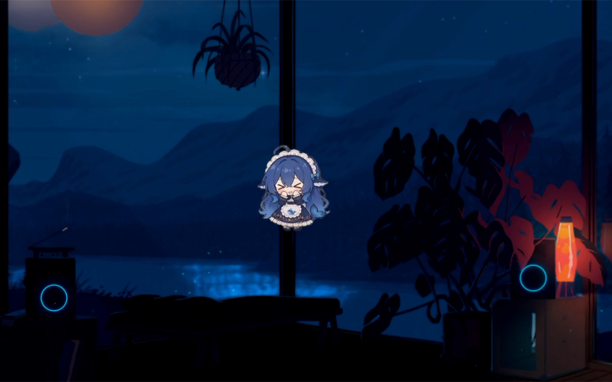
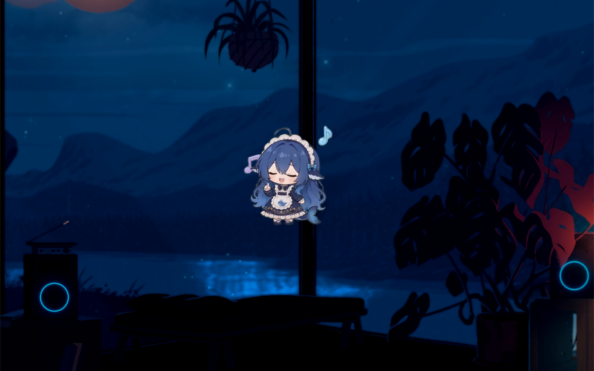

# ds-pet · Windows 桌面宠物

一只住在你桌面上的小宠物：会呼吸、发呆、打瞌睡、玩魔方、吃火锅，会跟着鼠标转头，
会被你拖着甩出去再撞墙弹回来。

它也能跟着 AI 干活的进度说话——开始处理、这一轮完成、出错、需要你确认，都会用气泡告诉你。

<p align="center">
  
</p>

> 本仓库是 **Windows 安装包** 的分发仓库。
> 宠物的创意、动画素材与全部代码来自原作者的开源项目：
> **[PC2005-cloud/dsh-pet](https://github.com/PC2005-cloud/dsh-pet)**

---

## 下载安装

前往 [**Releases**](../../releases/latest) 下载最新版安装包：

```
ds-pet-setup-x.y.z.exe
```

1. 双击运行（文件较大，首次启动需要等几秒）；
2. 按向导点「下一步」：选择安装位置 → 勾选想要的附加项 → 安装 → 完成。

**系统要求**：Windows 10 / 11（64 位）

## 使用

安装完成后宠物会出现在桌面上，托盘区也有图标。

| 操作 | 效果 |
| --- | --- |
| 左键点它 | 有反应：Q 弹、说话、换表情 |
| 按住拖动 | 拖着走；松手太快它会飞出去撞墙弹回来 |
| 右键 | 对话 / 动作 ▸ / 碎碎念 / 查看余额 / 设置 / 重载配置 / 回到初始位置 / 关闭程序 |
| 双击托盘图标 | 重新叫出宠物 |

**能做什么**

- 一百余个透明动画，随机播放、无缝衔接；
- 随机转向、屏幕漫游，也可以固定在原地不乱走；
- 多只宠物同屏，各自独立的开关、大小、位置；
- 自己写人设，让它用你喜欢的语气说话；
- 跟随 DSH 会话进度：开始处理 / 完成 / 出错 / 等待确认，配对应图标；
- 碎碎念、余额气泡、节日彩蛋；
- 可选开机自启、系统托盘常驻。

设置窗口里每一项都有说明，改完点「保存并应用」即生效。

<p align="center">
  
</p>

## 卸载

- 开始菜单 → ds-pet → **卸载 ds-pet**；
- 或 Windows 设置 → 应用 → 已安装的应用 → ds-pet → 卸载。

---

## 致谢与版权

| 角色 | 归属 |
| --- | --- |
| **原项目 / 原作者** | **PC2005-cloud** — https://github.com/PC2005-cloud/dsh-pet |
| **Windows 安装包** | **liyue** 打包制作 |

宠物的一切创意、动画素材与代码均来自原作者 **PC2005-cloud** 的开源项目 **dsh-pet**。
本仓库只把它打包成 Windows 下可以直接双击安装的形式，**不修改原项目源码，不对原项目主张任何权利**。

如果这个宠物让你开心，请去原仓库点一个 Star：
**https://github.com/PC2005-cloud/dsh-pet**

图标、动画与角色形象的版权归原作者所有，使用与再分发请遵循原项目的 [LICENSE](LICENSE)。

原项目的完整文档（插件用法、API、配置、自制宠物）见 [README.upstream.md](README.upstream.md)、
[API.md](API.md)、[CONFIG.md](CONFIG.md)、[MAKE-YOUR-OWN-PET.md](MAKE-YOUR-OWN-PET.md)。

---

## 给开发者

安装程序由 Inno Setup 6 构建，脚本与素材都在 [`packaging/`](packaging/)：

```
packaging/
├─ installer/          Inno 脚本（ds-pet.iss）、中文语言层、页面文案（pages.json）
├─ scripts/            素材生成脚本（一键画出全部界面底图与图标）
├─ assets/             生成的图片素材（脚本产出，勿手改）
├─ electron-builder.yml  exe 打包配置
└─ README.md           安装程序的设计说明
```

三步构建：

```powershell
# 1. 打包应用本体 → dsh-pet/dist-app/win-unpacked
cd dsh-pet
npm run dist

# 2. 生成安装程序素材（改过文案或配色才需要）
cd ..
powershell -NoProfile -ExecutionPolicy Bypass -File packaging\scripts\build-installer-assets.ps1

# 3. 编译安装包（产物输出到桌面）
& 'D:\Application\Inno Setup 6\ISCC.exe' 'packaging\installer\ds-pet.iss'
```

界面文字全部绘制在背景图上，因此改文案只需要编辑 `packaging/installer/pages.json` 后重跑第 2、3 步。
